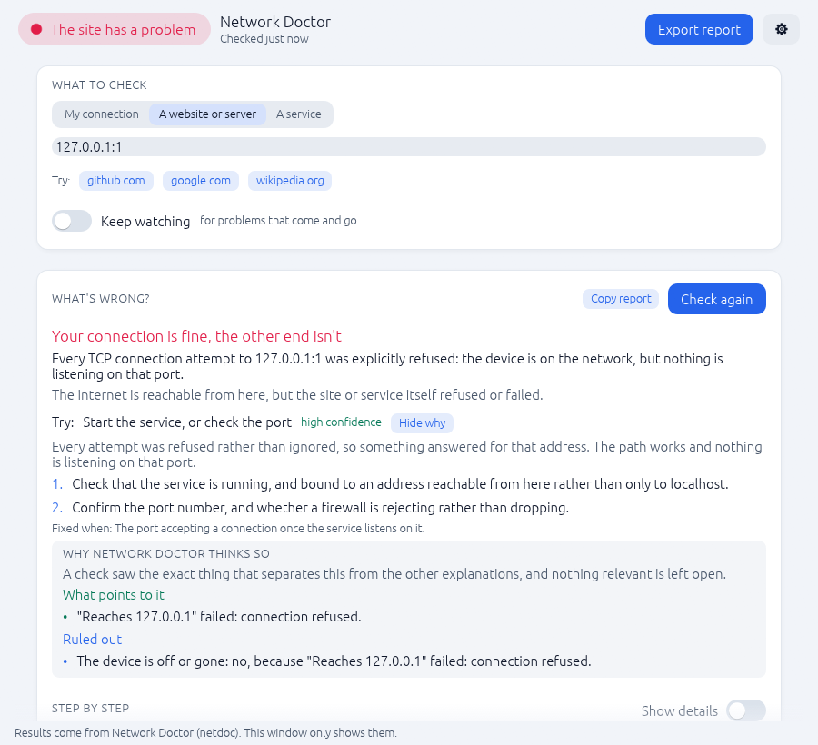
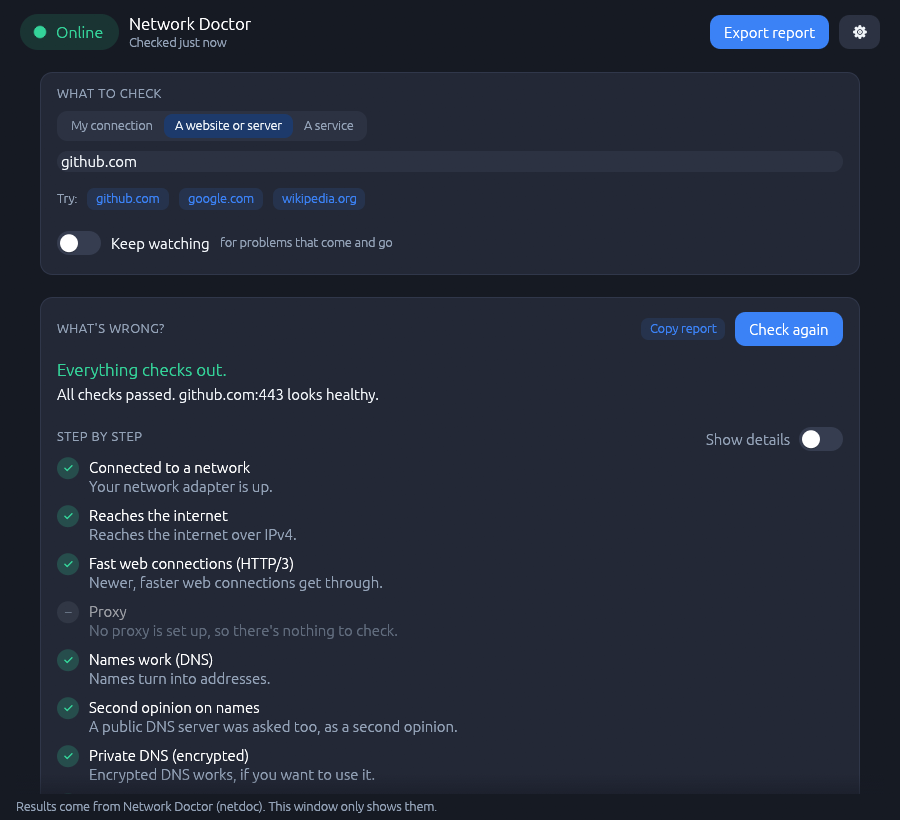

# Network Doctor desktop window

A small desktop window for `netdoc`, for people who would rather click than
type. It runs the `netdoc` program you already have and shows what it reports
in plain words. It adds no checks of its own to a diagnosis: every result on
screen comes from `netdoc --json`.

It is a separate Rust program in this folder. Nothing in the Go module imports
it, the `netdoc` binary does not change, and the Go toolchain never sees it.

| A healthy site | A problem, with the reasons | Dark theme |
| --- | --- | --- |
|  |  |  |

## What it does

- **Three things to check:** your own connection, a website or server, or a
  service profile (`--profile`).
- **A plain verdict first,** then every step `netdoc` ran, each with one
  sentence saying what it found.
- **"Why?"** shows the evidence behind a finding: what was observed, how
  confident `netdoc` is, and the other causes it ruled out.
- **Keep watching** runs `netdoc --watch` and keeps a short history, for
  problems that come and go.
- **Export report** writes the privacy-reduced `.ndoc` file
  (`netdoc --support`) to your home folder. It runs the same check again, for
  the same target and profile as the result on screen, so the file shows the
  network as it is at export time. It never replaces a file.
- Eight colour themes, light and dark.

## Build and run

It needs a Rust toolchain (edition 2024) and, to be useful, `netdoc`.

```sh
cd contrib/gui
cargo run --release
```

On Linux the window toolkit needs the usual desktop development packages
(on Debian or Ubuntu: `libxkbcommon-dev libwayland-dev libgl1-mesa-dev`).

```sh
cargo test
cargo clippy --all-targets -- -D warnings
```

## How it finds netdoc

In this order, and only at an absolute path:

1. a `netdoc` file beside the GUI's own binary,
2. the path in the `NETDOC` environment variable,
3. the folders on `PATH`.

Empty and relative `PATH` entries are skipped, so a file named `netdoc` in the
current folder is never run. On Windows the file is `netdoc.exe`.

## What it sends to netdoc

Only fixed argument lists, never a shell string: `--json`, `--profile NAME`,
`--watch --watch-interval Ns`, `--support FILE`, and the target after `--`, so
a target can never be read as an option. Text that comes back is stripped of
control characters before it is shown.

## Platforms

| | Linux | macOS | Windows |
| --- | --- | --- | --- |
| Run checks, Why?, watch, export | yes | yes | yes |
| `netdoc` stops if the window crashes | yes | no | no |

The last row uses a Linux process flag. Closing the window normally stops
`netdoc` on every system.

## Tests

`tests/fixtures` holds `netdoc --json` reports with documentation addresses
(`192.0.2.0/24`, `2001:db8::/32`) in place of real ones. The tests parse them
and check the wording the window would show.
