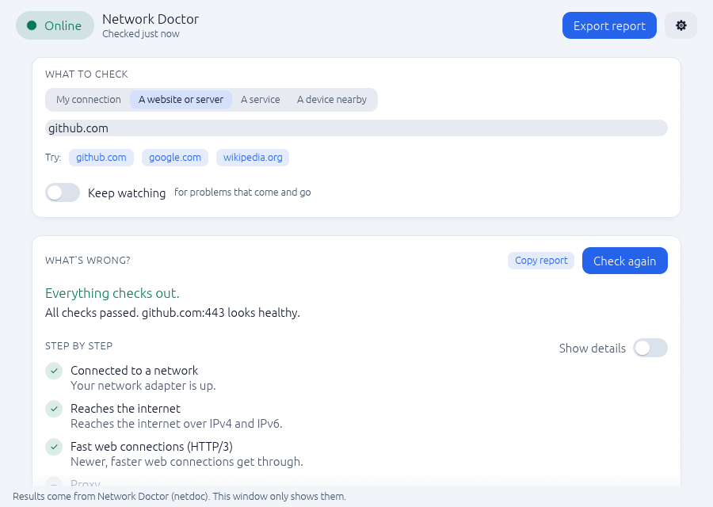

# Network Doctor desktop window

A small desktop window for `netdoc`, for people who would rather click than
type. It runs the `netdoc` program you already have and shows what it reports
in plain words. It adds no checks of its own to a diagnosis: every result on
screen comes from `netdoc --json`.

It is a separate Rust program in this folder. Nothing in the Go module imports
it, the `netdoc` binary does not change, and the Go toolchain never sees it.

| A healthy site | A problem, with the reasons | Dark theme |
| --- | --- | --- |
|  |  |  |

## What it does

- **Three things to check:** your own connection, a website or server, or a
  service profile (`--profile`).
- **A plain verdict first,** then every step `netdoc` ran, each with one
  sentence saying what it found.
- **"Why?"** shows the evidence behind a finding: what was observed, how
  confident `netdoc` is, and the other causes it ruled out.
- **Keep watching** runs `netdoc --watch` and keeps a short history, for
  problems that come and go.
- **Export report** writes the privacy-reduced `.ndoc` file
  (`netdoc --support`) to your home folder. It runs the same check again, for
  the same target and profile as the result on screen, so the file shows the
  network as it is at export time. It never replaces a file.
- **Copy report** copies the result as text. That text is **not** redacted: it
  can include addresses and network names. Use Export report for a
  privacy-reduced file.
- Eight colour themes, light and dark.

## Build and run

It needs Rust 1.95 or newer (edition 2024), the lowest version its dependencies declare, and, to be useful, `netdoc`.

```sh
cd contrib/gui
cargo run --release
```

On Linux the window toolkit needs the usual desktop development packages
(on Debian or Ubuntu: `libxkbcommon-dev libwayland-dev libgl1-mesa-dev`).

```sh
cargo test
cargo clippy --all-targets -- -D warnings
```

## How it finds netdoc

In this order, and only at an absolute path:

1. a `netdoc` file beside the GUI's own binary,
2. the path in the `NETDOC` environment variable,
3. the folders on `PATH`.

Empty and relative `PATH` entries are skipped, so a file named `netdoc` in the
current folder is never run. On Windows the file is `netdoc.exe`.

## What it sends to netdoc

Only fixed argument lists, never a shell string: `--json`, `--profile NAME`,
`--watch --watch-interval Ns`, `--support FILE`, and the target after `--`, so
a target can never be read as an option. Text that comes back is stripped of
control characters before it is shown.

## Update notice

Once per launch, the window asks netdoc for a newer stable release, in a background process. It runs `netdoc -update-check -json`, which makes the one GitHub request an update check makes. GitHub receives the public IP address the request originates from, which may be a proxy's address, as with any HTTPS request. If a newer release exists, a passive banner names it, with an "Open release page" button and a "Dismiss" button. Dismissing hides that release's banner, and a later release shows again.

The check is off when the setting "Check for updates when the window opens" is off, or when `NETDOC_NO_UPDATE_CHECK=1` is set. With that variable set, the switch shows off and cannot be turned on from the window. After a check that GitHub did not answer (offline, rate limited, or a bad answer), the window waits 24 hours before it asks again, and that wait is kept in its `update` file. This holds for a rate limit too. The reference and the manpage describe a one-hour retry after a rate limit, but that retry belongs to netdoc's automatic check in the interactive view. The window runs `netdoc -update-check`, which asks GitHub again whenever its last attempt did not succeed, so the window's own 24-hour wait is what limits its requests after a rate limit. Each launch the window does try asks netdoc again unless netdoc's last successful answer is under 24 hours old. A check the window closes before netdoc answers holds nothing, so the next launch asks again. A netdoc without the command, or one whose answer breaks the shared schema, shows no banner. The window keeps its memory of the check beside the theme, in a file named `update`. Two windows take turns on that file through a lock in `update.lock`, so one cannot undo the other's change. If a change cannot be saved, the window shows a warning under the banner: the change lasts only until the window closes. A choice that could not be saved is kept for the session, and the next change that saves applies it again. A change waits at most one second for the lock, then reports that it could not save. A missing file is the default, checks on. A file that exists but cannot be read keeps automatic checks off, and the switch shows off, until it can be read again: the window does not guess a default for it.

## Platforms

| | Linux | macOS | Windows |
| --- | --- | --- | --- |
| Run checks, Why?, watch, export | yes | yes | yes |
| `netdoc` stops if the window crashes | yes | no | no |

The last row uses a Linux process flag. Closing the window normally stops
`netdoc` on every system.

## Tests

`tests/fixtures` holds `netdoc --json` reports with documentation addresses
(`192.0.2.0/24`, `2001:db8::/32`) in place of real ones. The tests parse them
and check the wording the window would show.
